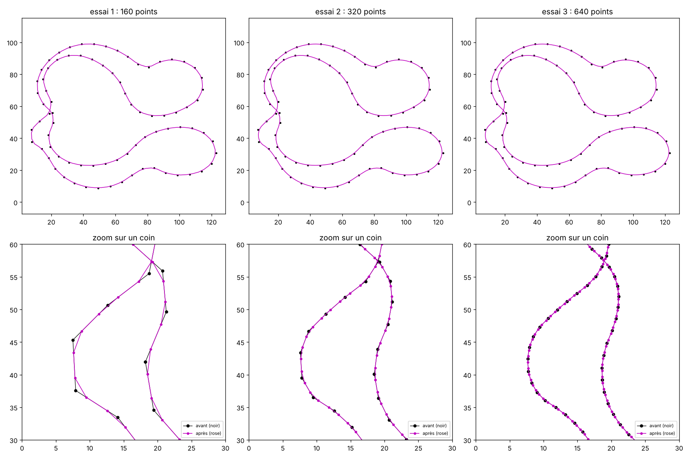
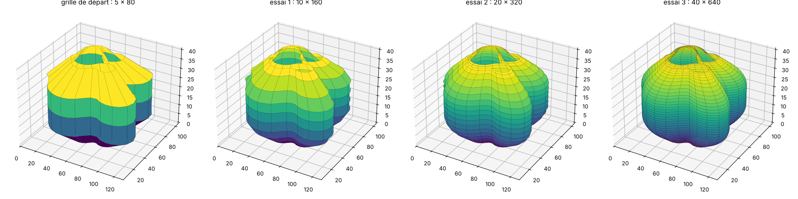
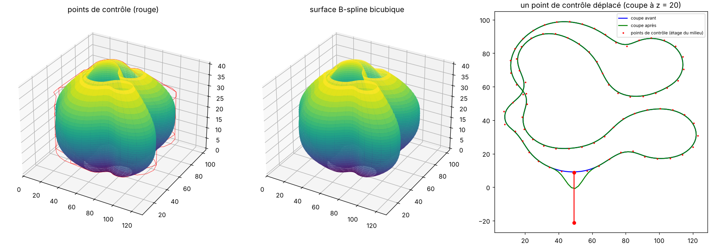

# TP 2026 - Reconstruction d'un contour par B-spline

Le sujet est dans `TP-B-spline.pdf`, les points du contour dans `points_contour_piece_bspline.csv`.

Il y a **deux versions** du TP :

## Version moi : `tp_bspline_milieux.py`

### L'idée de départ (et pourquoi elle ne marchait pas)

Idée : entre le point 1 et le point 2 on met un point au milieu, entre le point 2 et le point 3 aussi, etc.

- Si on **garde** les anciens points et qu'on ajoute les milieux : un milieu est **sur** le segment,
  donc la forme ne change pas du tout, on a juste plus de points sur les mêmes droites.
- Si on garde **seulement** les milieux : on a toujours 80 points et les angles restent aussi pointus
  (ils sont juste décalés et la forme rétrécit un peu).

### La correction : couper les coins (algorithme de Chaikin)

Sur chaque segment `[P, Q]` on met **deux** points au lieu d'un :

- un au quart : `3/4·P + 1/4·Q` (proche de P)
- un aux trois quarts : `1/4·P + 3/4·Q` (proche de Q)

On **saute les anciens points** : ce sont eux qui faisaient les coins. Chaque angle est donc remplacé
par deux angles plus doux. Le nombre de points double à chaque itération (80 → 160 → 320 → 640),
et en répétant, la courbe devient lisse.

Ce n'est pas un hasard : à la limite, on obtient exactement la **B-spline de degré 2** dont les
points du fichier sont les points de contrôle. C'est une autre façon de construire une B-spline,
sans formule, juste avec des moyennes de points.

Résultat avec 3 itérations. En haut : points de départ (noir) et courbe obtenue (rose).
En bas : zoom sur un coin, avant (noir) et après (rose) chaque itération.



On donne le nombre d'itérations en argument (3 par défaut) :

```
python tp_bspline_milieux.py 5
```

Remarque : vers (20, 55), la courbe se croise. Ça vient des points du fichier : le contour se croise
déjà à cet endroit, ce n'est pas un bug de la méthode.

## Version Claude : `tp_bspline_normal.py`

La méthode classique du sujet.
- charge les points et les affiche (`fig1_nuage.png`) ;
- construit une B-spline de degré 1, 2, 3 et 4 avec ses points de contrôle (`fig2_bspline_degres.png`) ;
- déplace un point de contrôle pour voir l'effet sur la courbe (`fig3_modif_controle.png`).

```
python tp_bspline_normal.py
```

Nuage de points du contour :


B-spline de degré 1, 2, 3 et 4 (points noirs = contour, rouge = points de contrôle, bleu = courbe) :


Effet d'un point de contrôle déplacé :


## Extension : surface B-spline

On passe d'une courbe à une **surface**. Pour ça on fabrique une **grille de points de contrôle** :
le contour du fichier est empilé sur 5 étages (z = 0, 10, 20, 30, 40). Le 1er et le dernier
étage sont rétrécis de moitié autour du centre de la forme, ce qui arrondit les bords en haut et en bas.
On obtient une grille de 5 × 80 points, et on construit la surface qui « habille » cette grille.

Les deux versions utilisent la même grille, donc on peut les comparer.

### Version moi : `tp_surface_milieux.py`

C'est la même idée que pour la courbe, **couper les coins (Chaikin)**, mais dans les deux sens :

1. sur chaque étage (dans le sens du contour, fermé), on coupe les coins ;
2. sur chaque colonne (de bas en haut, ouverte), on coupe aussi les coins. On garde le point du bas et celui du haut pour ne pas raccourcir la pièce.

À chaque itération, la grille double dans les deux sens (5 × 80 → 10 × 160 → 20 × 320 → 40 × 640)
et la surface devient lisse. À la limite, c'est une surface B-spline de degré 2 dans les deux sens.

```
python tp_surface_milieux.py 3
```



### Version Claude : `tp_surface_normal.py`

C'est la définition classique d'une surface B-spline, le **produit tensoriel** :

```
S(u, v) = Σ_i Σ_j  N_i(u) · M_j(v) · P_ij
```

- `u` fait le tour du contour : B-spline **cubique périodique**, donc la surface se referme sans couture ;
- `v` va du bas vers le haut : B-spline **cubique clamped**, donc la surface commence exactement au 1er étage et finit au dernier ;
- `P_ij` : la grille de points de contrôle, `N_i` et `M_j` : les fonctions de base B-spline (calculées avec `scipy`).

On calcule directement autant de points de la surface qu'on veut, sans itérations.
La figure montre la grille de contrôle (rouge), la surface bicubique, puis l'effet d'un point de contrôle
déplacé : sur la coupe à mi-hauteur, seule une petite zone autour du point bouge. C'est le **contrôle local** des B-splines.

```
python tp_surface_normal.py
```



**Différence entre les deux** : ma version donne une surface de degré 2 par subdivision, avec seulement des
moyennes de points. La version Claude donne une surface de degré 3, définie par une formule : on peut
l'évaluer en n'importe quel `(u, v)`, choisir le degré et déplacer un point de contrôle sans tout recalculer.

Remarque : vers (20, 55), le contour du fichier se croise déjà, donc la surface se croise aussi à cet endroit.

## Modules nécessaires

`numpy`, `scipy`, `matplotlib`
