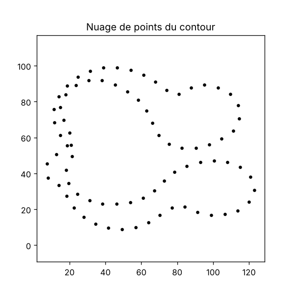
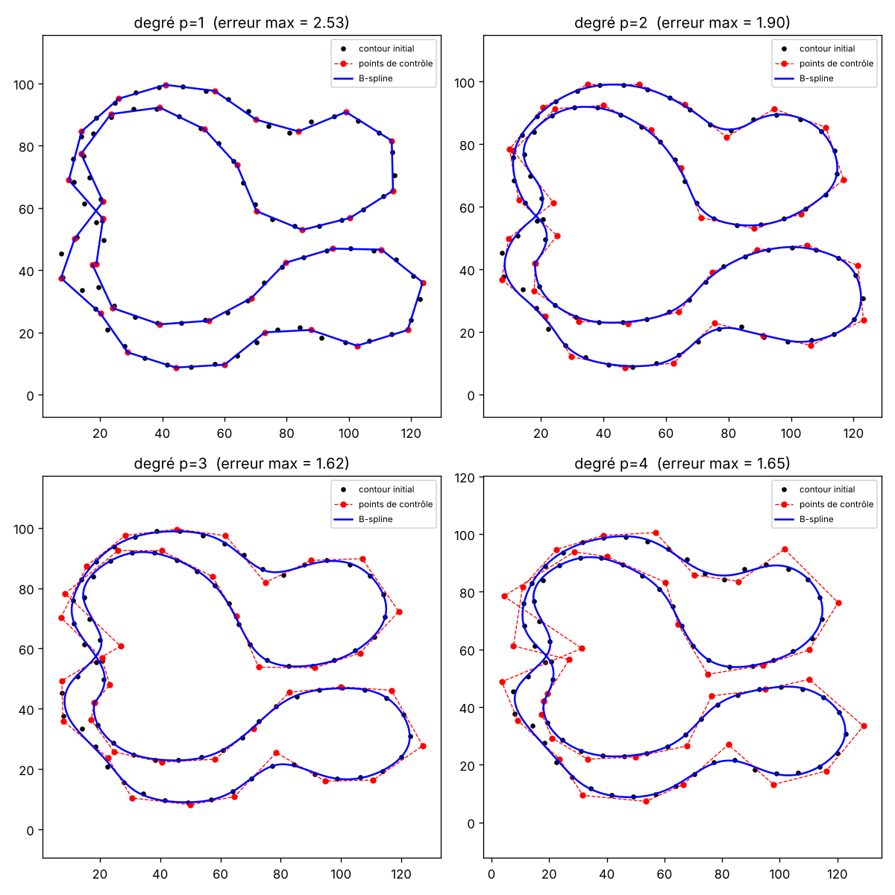
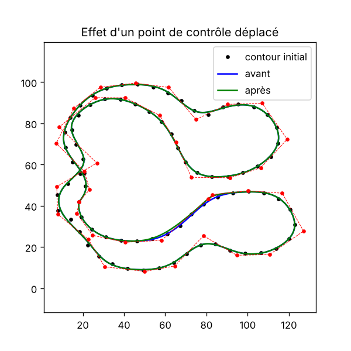
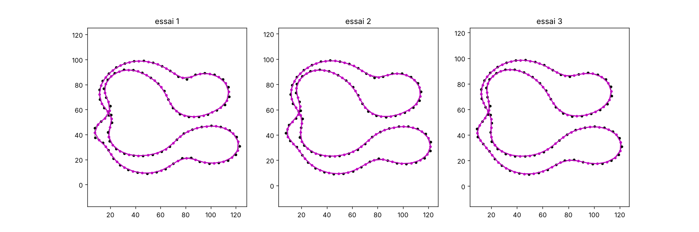

# TP 2026 - Reconstruction d'un contour par B-spline

Le sujet est dans `TP-B-spline.pdf`, les points du contour dans `points_contour_piece_bspline.csv`.

Il y a **deux versions** du TP :

## Version Claude : `tp_bspline_normal.py`

La méthode classique du sujet.
- charge les points et les affiche (`fig1_nuage.png`) ;
- construit une B-spline de degré 1, 2, 3 et 4 avec ses points de contrôle (`fig2_bspline_degres.png`) ;
- déplace un point de contrôle pour voir l'effet sur la courbe (`fig3_modif_controle.png`).

```
python tp_bspline_normal.py
```

Nuage de points du contour :



B-spline de degré 1, 2, 3 et 4 (points noirs = contour, rouge = points de contrôle, bleu = courbe) :



Effet d'un point de contrôle déplacé :



## Version moi : `tp_bspline_milieux.py`

Ma méthode : entre le point 1 et le point 2 on met un point au milieu, entre le point 2 et le point 3 aussi, etc.
À chaque itération on recommence avec tous les points, donc il y en a de plus en plus (le nombre double à chaque fois).
Le résultat est dans `fig4_methode_milieux.png` (avec un zoom pour bien voir les points).

Résultat avec 3 itérations (80 → 160 → 320 → 640 points), points noirs = anciens points, roses = nouveaux milieux :



On donne le nombre d'itérations en argument (3 par défaut) :

```
python tp_bspline_milieux.py 5
```

Remarque : les milieux sont sur les segments entre les points, donc la forme ne change pas, elle a juste plus de points.

## Modules nécessaires

`numpy`, `scipy`, `matplotlib`
