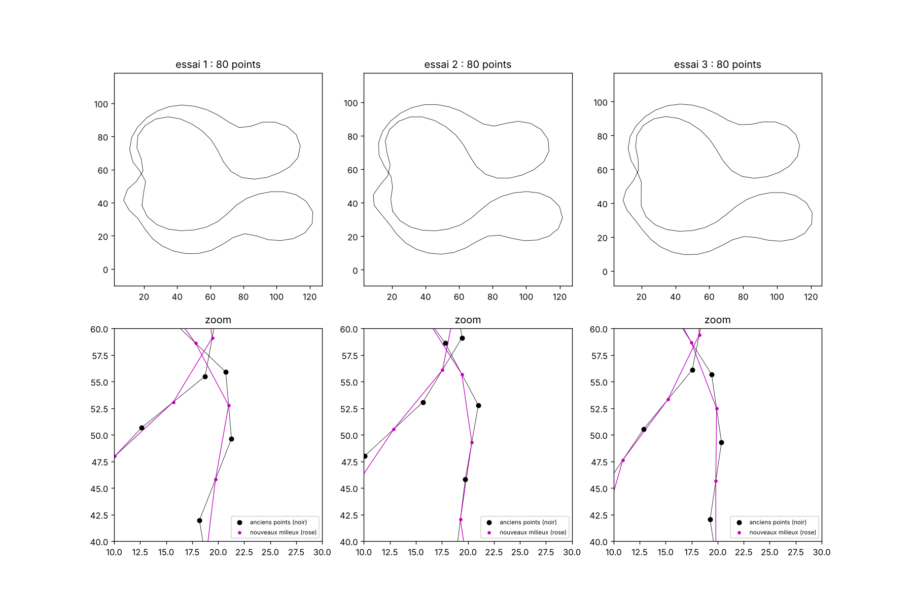
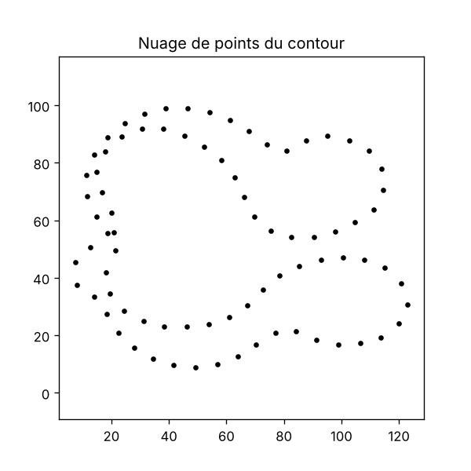
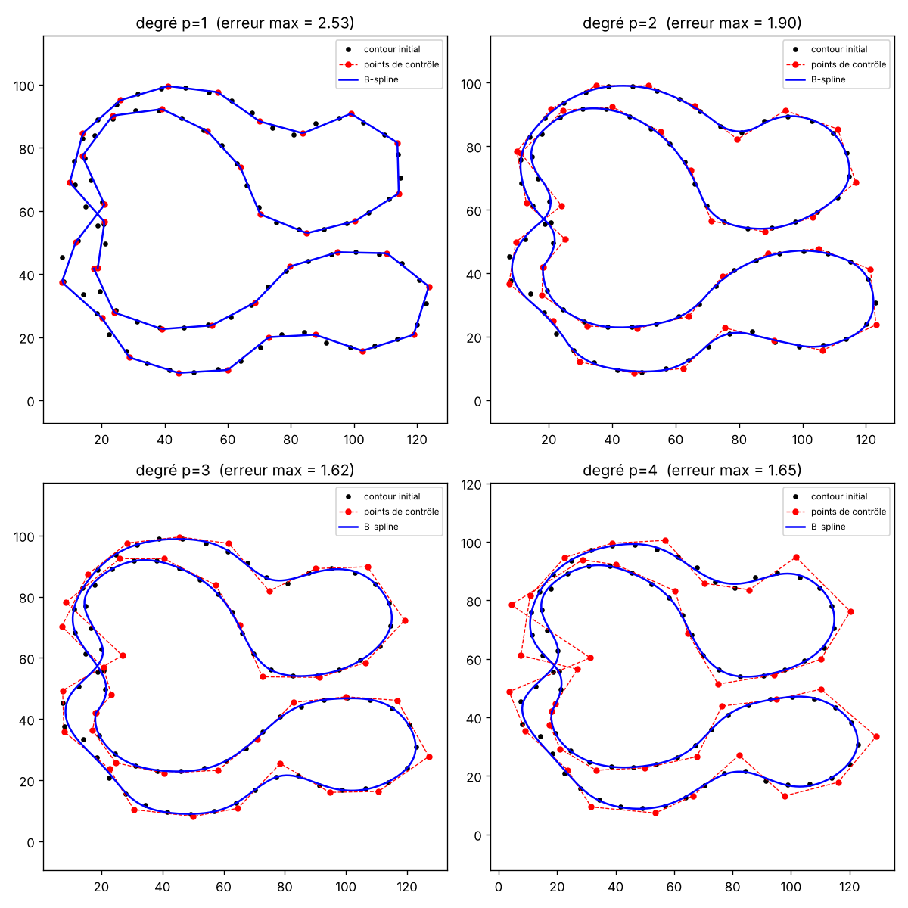
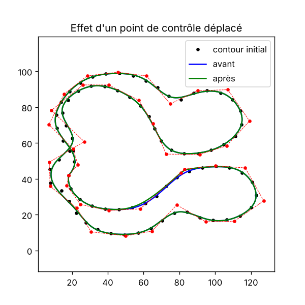

# TP 2026 - Reconstruction d'un contour par B-spline

Le sujet est dans `TP-B-spline.pdf`, les points du contour dans `points_contour_piece_bspline.csv`.

Il y a **deux versions** du TP :

## Version moi : `tp_bspline_milieux.py`

### L'idée de départ (et pourquoi elle ne marchait pas)

Idée : entre le point 1 et le point 2 on met un point au milieu, entre le point 2 et le point 3 aussi, etc.

- Si on **garde** les anciens points et qu'on ajoute les milieux : un milieu est **sur** le segment,
  donc la forme ne change pas du tout, on a juste plus de points sur les mêmes droites.
- Si on garde **seulement** les milieux : on a toujours 80 points et les angles restent aussi pointus
  (ils sont juste décalés et la forme rétrécit un peu).

### La correction : couper les coins (algorithme de Chaikin)

Sur chaque segment `[P, Q]` on met **deux** points au lieu d'un :

- un au quart : `3/4·P + 1/4·Q` (proche de P)
- un aux trois quarts : `1/4·P + 3/4·Q` (proche de Q)

On **saute les anciens points** : ce sont eux qui faisaient les coins. Chaque angle est donc remplacé
par deux angles plus doux. Le nombre de points double à chaque itération (80 → 160 → 320 → 640),
et en répétant, la courbe devient lisse.

Ce n'est pas un hasard : à la limite, on obtient exactement la **B-spline de degré 2** dont les
points du fichier sont les points de contrôle. C'est une autre façon de construire une B-spline,
sans formule, juste avec des moyennes de points.

Résultat avec 3 itérations. En haut : points de départ (noir) et courbe obtenue (rose).
En bas : zoom sur un coin, avant (noir) et après (rose) chaque itération.



On donne le nombre d'itérations en argument (3 par défaut) :

```
python tp_bspline_milieux.py 5
```

Remarque : vers (20, 55), la courbe se croise. Ça vient des points du fichier : le contour se croise
déjà à cet endroit, ce n'est pas un bug de la méthode.

## Version Claude : `tp_bspline_normal.py`

La méthode classique du sujet.
- charge les points et les affiche (`fig1_nuage.png`) ;
- construit une B-spline de degré 1, 2, 3 et 4 avec ses points de contrôle (`fig2_bspline_degres.png`) ;
- déplace un point de contrôle pour voir l'effet sur la courbe (`fig3_modif_controle.png`).

```
python tp_bspline_normal.py
```

Nuage de points du contour :



B-spline de degré 1, 2, 3 et 4 (points noirs = contour, rouge = points de contrôle, bleu = courbe) :



Effet d'un point de contrôle déplacé :



## Modules nécessaires

`numpy`, `scipy`, `matplotlib`
